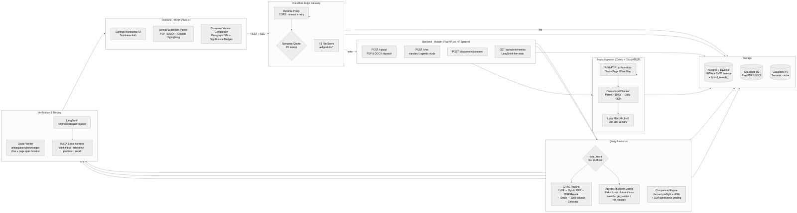
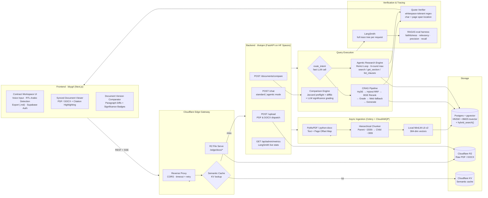
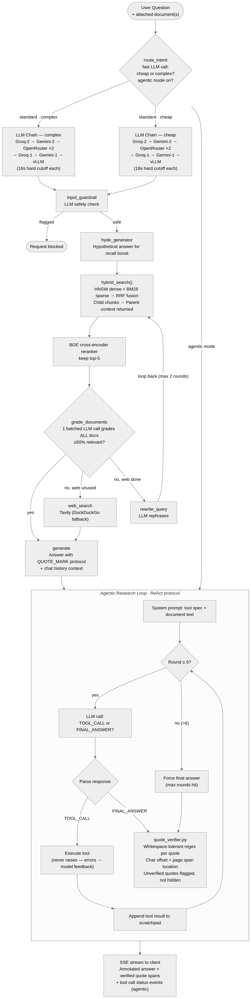
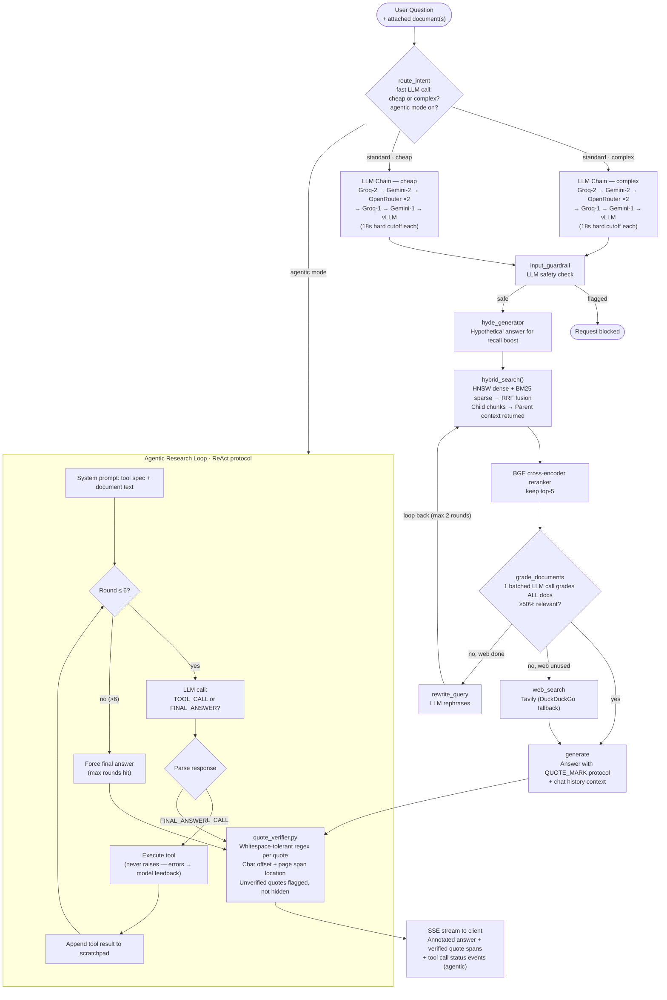

# Contract Copilot — Architecture & System Design

This document is the authoritative technical reference for the **Contract Copilot** system (`bbygrl` / `thotqen`): a production-grade legal document analysis platform built with LangGraph, FastAPI, and Next.js. It covers ingestion, hybrid retrieval, the CRAG query pipeline, agentic document research (Part C), document comparison (Part B), server-side citation verification, and the full observability stack.

---

## 🏗️ High-Level Architecture



**Top-level data flow:**

```
Next.js Client
  → Cloudflare Edge (CORS · semantic KV cache · R2 doc serving)
  → FastAPI backend (thotqen, hosted on HF Spaces)
    → intent router (cheap / complex / agentic)
    → [Async Ingestion: Celery → parse → chunk → embed → Postgres/pgvector]
    → [Standard CRAG pipeline | Agentic Research Loop | Comparison Engine]
    → Server-side Quote Verifier
  → SSE stream back to client (annotated answer + verified quote spans)
```

<details>
<summary>Mermaid source (editable)</summary>



</details>

---

## 🛠️ Technology Stack

### 1. Frontend (`bbygrl`)
- **Next.js (React 19)** — app router, SSE consumption, streaming chat UI.
- **Supabase Auth** — anonymous + email sign-in, JWT passed to backend.
- **mammoth.js** — client-side DOCX → HTML rendering for the document viewer.
- **Custom citation overlay** — verified quote spans highlight the exact passage in both PDF and DOCX viewers.

### 2. Edge (`edge-gateway`, Cloudflare Worker)
- Reverse proxy to FastAPI origin with hard timeout + 502/504 on failure (no opaque CORS errors).
- CORS enforced via an explicit origin allowlist.
- Direct R2 document serving at `/edge/docs/*`, bypassing the origin entirely.
- Semantic cache check/write against Cloudflare KV before hitting the LLM pipeline on `/chat`.

### 3. Backend (`thotqen`)
- **FastAPI** — async Python web framework with SSE support (`sse_starlette`).
- **LangGraph** — stateful agentic RAG pipeline (standard CRAG path).
- **Celery + RabbitMQ (CloudAMQP)** — background workers for async PDF/DOCX ingestion.
- **PyMuPDF (`pymupdf4llm`)** — PDF text extraction with per-page character offset tracking.
- **python-docx** — DOCX extraction with paragraph structure.
- **Supabase (PostgreSQL + pgvector + HNSW)** — stores documents, embeddings, jobs, chat history.

### 4. AI / ML
- **Intent Router** — a fast/cheap model classifies each query as `cheap` or `complex` before routing to the appropriate LLM chain tier.
- **LLM Fallback Chain**:
  - *Complex*: Groq#2 Llama 3.3 70B → Gemini#2 2.5 Pro → OpenRouter ×2 → Groq#1 → Gemini#1 → self-hosted vLLM
  - *Cheap*: same chain, smaller models first
  - Each provider wrapped in a hard **18s cutoff** via `ThreadPoolExecutor` (no same-provider retry; immediately moves to the next).
- **Embeddings**: `sentence-transformers/all-MiniLM-L6-v2` (local, 384-dim).
- **Reranker**: `BAAI/bge-reranker-base` (local BGE cross-encoder), keeps top-5.
- **CRAG web fallback**: Tavily (DuckDuckGo fallback if no `TAVILY_API_KEY`).

### 5. Observability
- **LangSmith** — every node in the LangGraph carries a `@traceable` span; full request renders as a single readable trace tree.
- **RAGAS** — offline eval harness (`scripts/generate_testset.py` + `scripts/run_evals.py`) scoring Context Precision, Context Recall, Answer Relevancy, and Faithfulness against a synthetic testset.
- **Live admin dashboard** — `GET /api/admin/metrics` pulls real run counts, success rate, latency, and token usage directly from the LangSmith API.

---

## 🔄 Document Ingestion Workflow

1. **Upload** — `POST /upload` dispatches to PyMuPDF (PDF) or python-docx (DOCX). File type and extractable-text validated up front; scanned-empty PDFs and wrong types rejected with explicit errors.
2. **Job created** — a `document_jobs` row is inserted; raw file stored in R2; `job_id` returned immediately.
3. **Queue** — Celery task dispatched to CloudAMQP.
4. **SSE stream** — client connects to `GET /upload/stream/{job_id}` for real-time progress (0% → 100%).
5. **Hierarchical chunking**:
   - **Parent** chunks (~1500 tokens) — stored for broad context retrieval.
   - **Child** chunks (~300 tokens) — embedded and indexed for precision search.
6. **Embedding** — child chunks batch-embedded locally (384-dim) and written to the `embeddings` table.
7. **FTS index** — a Postgres trigger auto-populates a `tsvector` column for BM25 keyword search.
8. **Page offset map** — character start/end of each page is recorded alongside the chunk; used by the quote verifier to report exact page numbers.

---

## 🤖 Query Pipeline (LangGraph — CRAG + Agentic)

Every user question is first classified by the intent router, then routes through one of three engines:



<details>
<summary>Mermaid source (editable)</summary>



</details>

### Hybrid Search (RRF)
The `hybrid_search` PostgreSQL function combines:
- **Dense retrieval** — HNSW vector similarity (child chunks, 384-dim)
- **Sparse retrieval** — BM25 full-text search (`tsvector`, GIN index)
- **Fusion** — Reciprocal Rank Fusion: `score = 1/(k + rank_dense) + 1/(k + rank_fts)`

When a child chunk is retrieved, its **parent chunk** content is returned to the LLM for broader context.

> **Why no Self-RAG grading loop?** An earlier version graded every generated answer for groundedness and auto-rewrote on failure. Measured live: the same query against the same document needed 0 extra rounds on one run and 3 on another — grading "is this answer grounded" is a far fuzzier judgment call than CRAG's per-document relevance check, and it was the dominant source of latency variance (up to ~145s on a bad run) without a proportionate correctness win. Removed outright; CRAG's cheaper, more predictable retrieval-quality loop stays.

---

## 🧠 Agentic Document Research (Part C, Option 2)

**File:** `app/services/agent_research.py`

### Why a hand-rolled ReAct protocol instead of native tool-calling

The LLM is a 5-6 provider fallback chain (Groq / Gemini / OpenRouter / self-hosted vLLM). Native function-calling support is **inconsistent** across this chain — vLLM only supports it with a specific server-side flag that may not be set, and LangChain's `.with_fallbacks()` wrapper doesn't expose `.bind_tools()` on the combined runnable anyway.

A hand-parsed text protocol — `TOOL_CALL: {"name": ..., "arguments": ...}` / `FINAL_ANSWER: ...` — works identically across every provider. It also means malformed or invented tool calls (bad JSON, unknown tool name, wrong argument type) are handled **by construction**: they become a plain-English error string fed back to the model so it can self-correct, never a crash or exception bubble.

### Available tools

| Tool | Signature | What it does |
|---|---|---|
| `search_document` | `(query: str)` | Full hybrid search (same as standard pipeline) scoped to the current document |
| `get_section` | `(number: int)` | Returns the full text of the N-th detected clause/section |
| `list_clauses` | `()` | Lists all detected clause headings with their index numbers |

### Execution loop

```
for round in range(MAX_ROUNDS=6):
    ask LLM → "TOOL_CALL: {...}" or "FINAL_ANSWER: ..."

    if TOOL_CALL:
        parse JSON (malformed → error string, not raise)
        run tool (never raises — all errors become string results)
        emit SSE status event ("🔍 Searching for X...")
        append result to scratchpad
        continue

    if FINAL_ANSWER:
        break

if MAX_ROUNDS exhausted:
    force one final answer-only call
```

### Quote verification applies to agentic answers too

The final answer passes through the same `quote_annotator.py` → `quote_verifier.py` pipeline as the standard chat path. Agentic mode claims are verified against the source document character-for-character; unverified quotes are flagged in the UI, not silently removed.

---

## 📑 Document Comparison Engine (Part B)

**File:** `app/services/document_compare.py`

### Pipeline

1. **Jaccard pre-flight** — bag-of-words Jaccard similarity computed between the two document texts.
   - `< 0.05` → blocked as unrelated (difflib on unrelated docs produces 100% false positives).
   - `0.05–0.18` → partial overlap, proceeds with a warning.
   - `≥ 0.18` → full comparison.

2. **Segment splitting** — tries clause/heading detection first (`detect_clauses`), falls back to blank-line paragraphs (DOCX extraction), then individual lines. Single-newline PDFs would otherwise collapse into a single diff block.

3. **difflib SequenceMatcher** — over the list of segments (not characters), producing `replace`, `insert`, `delete`, and `equal` opcodes.

4. **LLM significance grading** — one **batched** LLM call grades all modified pairs at once (same cost rationale as `grade_documents` in CRAG), producing a plain-language summary + significance level:
   - `minor` — rewording, formatting, typo fixes — meaning unchanged.
   - `moderate` — real but limited change (notice period, defined term).
   - `major` — shifts rights, obligations, money, liability, or risk.

5. **Sort** — changes sorted `major → moderate → minor` so the most substantive surface first.

---

## ✅ Server-Side Citation Verification

**File:** `app/services/quote_verifier.py`

The model is instructed to wrap every verbatim quote in a sentinel character (`\x1d...\x1d`). After generation:

1. All sentinels are extracted.
2. Each quote is searched in the document's **raw extracted text** — the server never trusts any position/page the model reports.
3. Matching is **whitespace-tolerant but otherwise exact**: tokens are joined by `\s+` so extraction line-wrap artifacts don't break genuine matches. Every word must appear, in order, verbatim — a paraphrase does not verify.
4. Case-only mismatches (OCR/extraction artifact) are accepted as verified but flagged separately.
5. On a match, the exact character span and page number are returned.
6. **Unverified quotes are flagged in the UI — not removed.** The user sees exactly which claims weren't backed by the source.

---

## 🧩 Component Map

### Backend Services (`thotqen/app/`)

| File | Role |
|---|---|
| `main.py` | FastAPI app factory, CORS, lifespan hooks |
| `routes.py` | `/upload`, `/upload/status/{id}`, `/upload/stream/{id}`, `/ask`, `/chat` |
| `admin_routes.py` | `GET /api/admin/metrics` — live LangSmith run stats |
| `cache_routes.py` | Semantic cache check/write, Cloudflare KV invalidation |
| `core/config.py` | All env vars (Groq, Gemini, vLLM, DB, Celery, Supabase, LangSmith) |
| `core/auth.py` | JWT auth via `python-jose` |
| `worker/celery_app.py` | Celery factory wired to CloudAMQP |
| `worker/tasks.py` | `ingest_document_task` — chunking, embedding, DB writes with progress |
| `services/rag.py` | `ask_question` entry point; Intent Router → `run_rag_graph` or `run_agent` |
| `services/langgraph_rag.py` | Full LangGraph CRAG pipeline, LangSmith tracing |
| `services/agent_research.py` | Agentic Research loop (Part C, Option 2) |
| `services/document_compare.py` | Document comparison engine (Part B) |
| `services/quote_verifier.py` | Server-side quote location — char span + page |
| `services/quote_annotator.py` | Annotates model output with verified span metadata |
| `services/clause_detection.py` | Regex-based heading/clause detector (supports `list_clauses` / `get_section`) |
| `services/docx_loader.py` | DOCX text extraction with paragraph structure |
| `services/chunking.py` | `hierarchical_chunk_text` — Parent → Child splitting |
| `services/document_service.py` | DB writes for parent/child chunks |
| `services/embeddings.py` | `embed_text` — local sentence-transformers |
| `services/vectorstore.py` | PGVector wrapper (HNSW-backed) |
| `services/history.py` | `PostgresChatMessageHistory` per session |
| `db/database.py` | psycopg3 connection pool |
| `db/init.sql` | Full schema: documents, chunks, embeddings, jobs, cache, `hybrid_search()` |
| `scripts/generate_testset.py` | Synthetic RAGAS testset generation |
| `scripts/run_evals.py` | Offline RAGAS eval (faithfulness, relevancy, precision, recall) |
| `scripts/render_diagrams.py` | Regenerates `docs/*.png` via mermaid.ink |

---

## 💡 Key Design Decisions

1. **Intent Routing over manual model selection** — a cheap LLM classifier routes each query to the most cost-efficient capable model, removing the need for the user to pick a model tier.
2. **Hierarchical chunking** — child chunks are indexed for precision; parent chunks are returned to the LLM for rich context — best of both worlds.
3. **Hybrid Search (RRF)** — BM25 catches exact-match keywords (names, article numbers, defined terms); vector search catches semantic similarity. RRF fuses both without needing score normalization.
4. **HyDE** — generating a hypothetical answer before retrieval drastically improves semantic recall for complex or abstract queries.
5. **ReAct text protocol for agentic mode** — works uniformly across the entire multi-provider fallback chain; malformed calls become error feedback rather than crashes.
6. **Batched LLM calls for grading** — both `grade_documents` (CRAG) and `_classify_changes` (comparison) grade all items in one LLM call rather than N separate calls, avoiding linear cost growth with document/diff size.
7. **Async ingestion with SSE** — large documents are processed in the background; the frontend receives real-time progress via Server-Sent Events instead of polling.
8. **Server-side quote verification** — the backend re-locates every quote itself rather than trusting any position the model reports; unverified quotes are flagged, not hidden.
9. **Cross-provider fallback, not same-provider retry** — a stuck or rate-limited provider is skipped immediately (18s hard cutoff per provider), not retried; the chain degrades gracefully to the next available provider.
10. **Cutting Self-RAG's post-generation grading** — measured live to be the dominant source of latency variance (up to 145s on bad runs) with no proportionate correctness win versus CRAG's cheaper document-relevance check. Good engineering sometimes means deleting a feature once data says it isn't earning its keep.
11. **Jaccard pre-flight for comparison** — blocks unrelated-document comparisons before running difflib, which would otherwise produce 100% false positives (every segment as "replaced") on documents with no shared vocabulary.
12. **Offline RAGAS as a regression gate** — eval metrics run on demand via a script, not inline, to keep request latency minimal; the goal is catching quality regressions before merge, not inflating live metrics.
