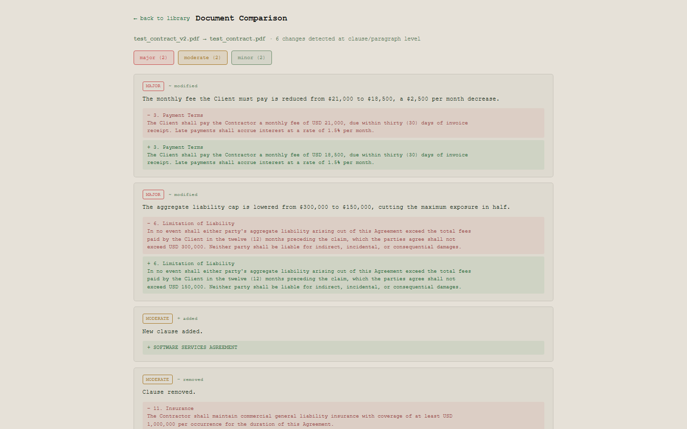

# Contract Copilot — Legal Document Analysis

A web app for analysing legal contracts. Upload a PDF or DOCX contract, ask questions about it in a chat, and get answers backed by **quotes that are verified against the actual document text before they're ever shown to you** — not just asserted by the model.

Backend: this repo (`agentic-ai`), FastAPI + LangGraph. Frontend: a separate Next.js app (`bbygrl`, in the sibling directory) — see [Running locally](#running-locally) for both.

**Live app:** https://agentic-ai-application.ayushgurung.com/

## Screenshots

| Upload / library | Chat with verified quotes |
|---|---|
|  |  |

| Citation highlighting | Document comparison |
|---|---|
|  |  |

## What it does

- **Upload** a PDF or DOCX contract. Other file types are rejected with a clear message. A scanned PDF with no extractable text is rejected explicitly (not silently saved as empty). Processing runs in the background with live progress, not a blind spinner.
- **Chat** with an uploaded document. Answers stream in, chat history is saved per document and reopenable, and you can stop an answer mid-generation.
- **Verified quotes** — every factual claim the model makes about the document is backed by a quote, and that quote is located in the real, extracted document text server-side (whitespace-tolerant, never trusting any position the model itself reports) before it's shown. A quote that can't be located is clearly flagged as unverified, never presented as genuine.
- **Large documents** (150+ pages) are handled via hybrid (vector + keyword) retrieval rather than stuffing the whole thing into one prompt, and the model is explicitly instructed not to claim a clause doesn't exist just because it wasn't in what was retrieved.
- **Citation highlighting** — click a verified quote and the source document opens, scrolled and highlighted to that exact passage, for both PDF and DOCX.
- **Multi-document questions** — select several documents in the library and ask one question across all of them; the answer compares across documents, and each quote is verified against its own source document.
- **Document comparison** — upload two versions of a contract and see what changed, diffed at paragraph level with a plain-language, significance-rated summary (a reworded sentence is "minor"; a liability cap changing is "major").
- **Agentic document research (Part C, Option 2)** — an optional "research mode" per document where the model is given tools (`search_document`, `get_section`, `list_clauses`) and decides what to look up itself, across a bounded number of rounds, shown live as it happens.

## How quote verification works, and where it could fail

The model is instructed to wrap every verbatim quote it uses in a sentinel marker. Once generation finishes, `app/services/quote_verifier.py` re-locates each quote in the document's actual extracted text itself — it never trusts any position/page the model reports. Matching is whitespace-tolerant (extraction adds/removes line breaks and spaces without changing words) but otherwise exact: every word must appear, in order, verbatim — a paraphrase does not verify. A quote that can't be found is flagged unverified in the UI, not removed, so the user can see exactly what wasn't backed by the source.

**Where it can fail:** if extraction itself drops or garbles characters (a genuinely malformed PDF, or a scanned page that slipped past the empty-text check with a tiny amount of noise text), a real quote can fail to verify even though it's "there" in the source visually. It also can't tell a *correct* quote from a *selectively misleading* one — verification only confirms the words exist in the document, not that quoting them in isolation is fair.

## How large documents are handled

Documents are chunked hierarchically (large parent chunks for context, small child chunks for precision) and indexed with both vector (HNSW) and keyword (BM25/tsvector) search, fused with Reciprocal Rank Fusion, scoped to exactly the document(s) attached to the current chat (not pooled across every document a user has ever uploaded). The model only ever sees the top retrieved passages for a given question, and is explicitly instructed to say "not found in what was retrieved" rather than confidently asserting a clause is absent from the whole document.

## Part C: Agentic document research (Option 2)

Chosen over tracked-change redlining because it builds directly on infrastructure already in this codebase (the live per-step status streaming), while redlining is an unrelated OOXML-manipulation problem with nothing to build on. Toggle "research mode" in a single-document chat to enable it.

Implementation notes: rather than native provider function-calling (inconsistent across the multi-provider fallback chain this app uses — Groq/Gemini/OpenRouter/self-hosted vLLM — and unreliable even where supported: Groq's gpt-oss models have a confirmed bug where they attempt a native tool call even when none is declared), tool calls are parsed from a hand-rolled `TOOL_CALL: {...}` / `FINAL_ANSWER: ...` protocol (`app/services/agent_research.py`). This also means malformed/invented tool calls (bad JSON, unknown tool name, wrong argument types) are handled by construction — they become an error string fed back to the model, never a crash. Hard-capped at 6 rounds. The final answer goes through the same quote-verification pipeline as the standard chat path.

**Hardest part / what's weakest:** clause/section detection (`detect_clauses` in `agent_research.py`) is a regex heuristic over common contract heading shapes (numbered clauses, "Section N", ALL-CAPS headings) — it isn't a real document-structure parser, so `list_clauses()`/`get_section()` can miss or mis-split sections in a contract with an unusual heading style. `search_document` doesn't have this limitation (it's the same hybrid search used everywhere else).

## What's finished and what's not

**Finished:** everything in Part A, Part B, and Part C (Option 2) described above.

**Known limitations:**
- Answer "streaming" generates the full answer server-side first (so it can be quote-verified before anything is shown), then sends it to the client in chunks for a real-time typing feel. The user-visible behavior matches the spec (incremental, stoppable, partial text kept), but it isn't literal token-by-token streaming from the model.
- Stopping an answer is a client-side cutoff — the full answer is already persisted server-side by the time any text streams out, so reopening a stopped conversation later shows the complete answer, not the truncated version you stopped at.
- An edge-caching Cloudflare Worker is referenced in this codebase's semantic-cache write path but lives in a separate, undeployed repo — a cache hit there (if that Worker is ever deployed) would replay an old answer without the quote-verification metadata sidecar. Not exercised in a plain deployment of this repo.
- Extras (anonymization, export, clause-extraction UI, Arabic/RTL, voice input, crash-recovery for in-flight background jobs) were intentionally left for after Parts A–C, per the assignment's own priority guidance, and are not built.

## Tech stack

FastAPI (Python) + LangGraph for the backend; Next.js (React) for the frontend (`../bbygrl`). PostgreSQL (Supabase) with `pgvector` for hybrid search. Celery + RabbitMQ for background document ingestion. Groq, Gemini, OpenRouter and a self-hosted vLLM server chained as automatic fallbacks for the LLM, read from environment variables — see `app/core/config.py`. PDF parsing via PyMuPDF, DOCX via `python-docx` (server) and `mammoth` (client-side rendering for the viewer).

## Running locally

### Backend (this repo)

```bash
pip install -r requirements.txt
cp .env.example .env   # fill in DATABASE_URL and at least one LLM provider key — see app/core/config.py for every var read
uvicorn app.main:app --reload --port 8000
```

A Celery worker is needed for document ingestion (chunking/embedding runs in the background):

```bash
celery -A app.worker.celery_app worker --loglevel=info --concurrency=1
```

The database schema is applied automatically on API startup (`init_db()` in `app/db/database.py`, idempotent — safe to re-run), or manually via `python -m app.db.migrate`.

### Frontend (`../bbygrl`)

```bash
cd ../bbygrl
npm install
cp .env.example .env.local   # NEXT_PUBLIC_API_URL (this backend) + NEXT_PUBLIC_SUPABASE_* (anonymous auth)
npm run dev
```

Open `http://localhost:3000/library` to upload a document, or `/upload` for the chat directly.

## API surface (new in this assignment pass)

- `POST /upload?session_id=` — PDF/DOCX upload, now format-dispatching + page-offset tracking for citation highlighting
- `GET /documents`, `GET /documents/{id}/file`, `GET /documents/{id}/text`, `DELETE /documents/{id}` — document library
- `GET /sessions/{id}/documents` — which document(s) a chat is grounded in
- `POST /sessions` — now accepts `document_ids` for multi-document sessions
- `POST /chat` — now accepts `mode: "standard" | "agentic"`
- `POST /documents/compare` — paragraph-level comparison between two documents
